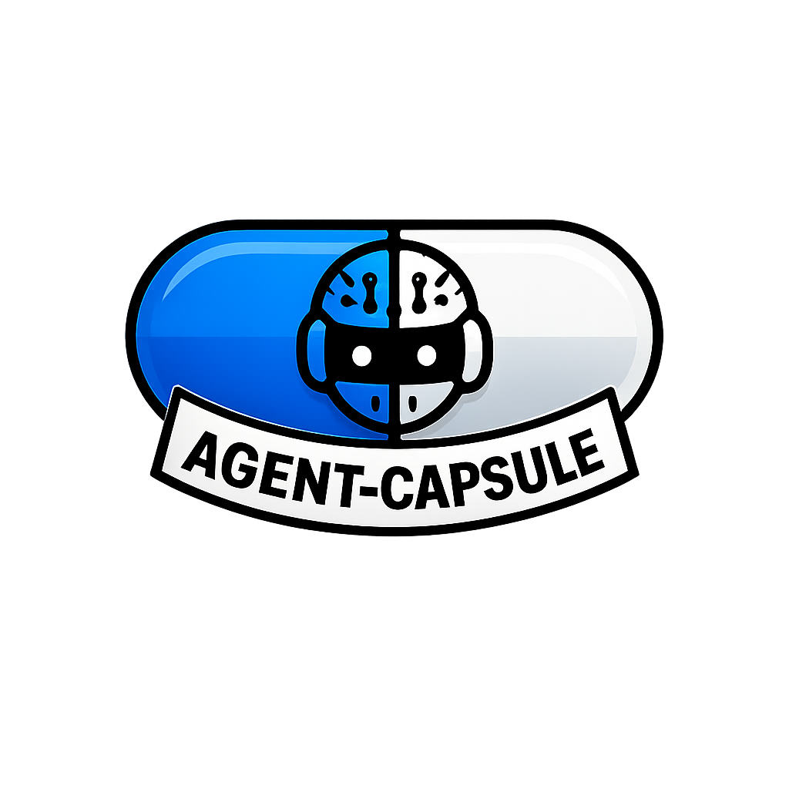

<p align="center">
  
</p>

# agent-capsule

[![lint][lint-badge]][lint-workflow]

Run a coding agent, [Claude Code](https://code.claude.com/docs) by
default, [OpenAI Codex CLI](https://github.com/openai/codex), or
[opencode](https://opencode.ai), inside a rootless
[Podman](https://podman.io/) container that shares a single project directory with the host.

One shell script, one Dockerfile. The container uses the project's resolved host path
as its working directory and also exposes it at `/workspace` for compatibility. It
gets an isolated home at `/home/dev`, a Node and Go toolchain, and hard resource
limits. Everything else on the host stays out of reach.

## What you get

- Rootless containment: container root maps to your host UID, so files written in
  the project are owned by you. All capabilities dropped, no-new-privileges,
  memory/CPU/pids limits.
- One login for all sessions: authenticate once per agent with `--auth-login`
  (`--agent codex --auth-login` for Codex); the selected credentials file is
  live-shared into every session for that agent, token refreshes included.
- Isolated sessions: each project or named session gets its own `/home/dev`, so
  parallel agents do not trample each other's transcripts or settings.
- Shared knowledge: one global rules file (`~/.agent-capsule/CLAUDE.md`) is mounted
  into every session at the agent's expected path, and Claude's per-project memory
  is pooled across sessions and linked worktrees of the same repo.
- Tools you list, extensions you turn on: each agent's image holds the CLIs you list
  in `AGENT_CAPSULE_TOOLS`, and nobody gets one they did not list. Extensions sit in
  every image, inert until `--with` turns them on, so `--with` never rebuilds.
- Defaults you keep: exported `AGENT_CAPSULE_*` variables hold your usual add-ons
  so they are not retyped on every run.

## Requirements

- Linux with rootless Podman configured, **or** macOS with Podman (see [macOS](docs/macos.md))
- bash 4.4 or later. macOS ships bash 3.2 as `/bin/bash`, so install a current one,
  for example with Homebrew.
- `make` for `make install` (or copy `agent-capsule`, `Dockerfile`,
  `entrypoint.sh`, and the `plugins/` directory manually)

## Install

```sh
make install                    # -> ~/.local/bin/agent-capsule
                                #    ~/.local/share/agent-capsule/{Dockerfile,entrypoint.sh,plugins/}
make install PREFIX=/usr/local  # alternative destination
make uninstall                  # remove what make install copied
nix profile install github:Niahh/agent-capsule  # or with Nix
```

To update, pull the repository and run `make install` again.

Each agent gets its own image, tagged with the agent's name. It builds on first run
and again when your tool list changes, never because of `--with`. Each rebuild also
removes the untagged image it replaced, which `AGENT_CAPSULE_PRUNE=0` disables. Podman keeps layers that images
share, and cannot remove an image a running container still uses. So the guarantee is
one tagged runnable image, not one object in container storage.

It also performs a full rebuild once the last no-cache refresh is more than seven
days old, to pick up new tool releases. See
[Tool versions and upgrades](docs/configuration.md#tool-versions-and-upgrades). Use `--build` to rebuild
from scratch at any time.

## Quick start

```sh
agent-capsule --auth-login          # once: log in, credentials are shared afterwards
agent-capsule ~/code/myapp          # run Claude Code in a capsule on a project
agent-capsule --shell .             # a shell inside the capsule instead of the agent
agent-capsule --agent opencode .    # run opencode instead of Claude Code
agent-capsule --session fix-auth ~/code/myapp   # named session for parallel agents
agent-capsule --with superpowers .              # activate bundled development skills
agent-capsule --with explain-diff .             # explain a change as interactive HTML
agent-capsule --vault="$HOME/Notes" .                 # Obsidian vault over MCP
agent-capsule --with worklog --vault="$HOME/Notes" .  # log significant work
export AGENT_CAPSULE_TOOLS=gh,glab,kubernetes,talos   # CLIs in your image: gh, glab, kubectl, helm, talosctl
agent-capsule --with github .                   # gh with the host gh login, git over HTTPS
agent-capsule --with gitlab .                   # glab with the host glab login, git over HTTPS
agent-capsule --ca .                            # trust a private CA to reach self-hosted resources
agent-capsule . -- -p "explain this repo"       # args after -- go to the agent
agent-capsule . -- -p "list the TODOs" > out.md # only the answer reaches stdout
agent-capsule --agent codex --auth-login        # once: log in to Codex instead
agent-capsule --agent codex ~/code/myapp        # run Codex CLI in a capsule on a project
```

## Agents

Claude Code is the default. `--agent codex` runs the OpenAI Codex CLI and `--agent
opencode` runs [opencode](https://opencode.ai); `AGENT_CAPSULE_AGENT` sets the same
default, and `--agent list` prints the known agents.

Logins, API keys and how the agents differ: [Agents](docs/agents.md).

## Tools and integrations

Tools are CLIs built into the image, listed once in `AGENT_CAPSULE_TOOLS`. A change to
the list rebuilds the image once.

| Tool | What it installs | Details |
|---|---|---|
| `gh` | the GitHub CLI | [GitHub](docs/integrations.md#github) |
| `glab` | the GitLab CLI | [GitLab](docs/integrations.md#gitlab) |
| `kubernetes` | kubectl and helm | [Clusters](docs/integrations.md#kubernetes-and-talos) |
| `talos` | talosctl | [Clusters](docs/integrations.md#kubernetes-and-talos) |

Integrations are turned on per run with `--with`, or by default with
`AGENT_CAPSULE_WITH`. They never rebuild the image.

| Integration | What it does | Agents | Details |
|---|---|---|---|
| `superpowers` | Superpowers development skills | all | [Superpowers](docs/integrations.md#superpowers) |
| `explain-diff` | explains a change as interactive HTML | all | [explain-diff](docs/integrations.md#explain-diff) |
| `anydoc` | converts documents to Markdown | all | [anydoc](docs/integrations.md#anydoc) |
| `vault` | mounts the Obsidian vault, served over MCP | all | [Vault](docs/integrations.md#obsidian-vault-over-mcp) |
| `worklog` | logs work in the vault; needs `vault` | claude | [Work log](docs/integrations.md#work-log-in-obsidian) |
| `github` | lends gh the host's login, git over HTTPS; needs `gh` | all | [GitHub](docs/integrations.md#github) |
| `gitlab` | lends glab the host's login, git over HTTPS; needs `glab` | all | [GitLab](docs/integrations.md#gitlab) |
| `ca` | trusts the CAs in `AGENT_CAPSULE_CA_CERTS` | all | [Private CA](docs/integrations.md#private-ca) |

## Flags at a glance

- `--agent NAME`: use `claude`, `codex`, or `opencode`; `list` prints the choices.
- `--session NAME`: use a named per-session home.
- `--auth-login`: authenticate the selected agent in its isolated auth home.
- `--shell`: start Bash instead of the agent.
- `--offline`: disable container networking.
- `--keep-id`: use the host UID and GID inside the container.
- `--with TOOL[,TOOL]`: activate integrations; `list` prints them and `none` clears
  the selection.
- `-m, --mount SRC[:DEST][:ro]`: add a file or directory bind mount; repeat as needed.
- `--ca`: add `ca` to this run's integrations.
- `--vault[=PATH]`: add `vault` to this run's integrations, from `PATH` if given.
- `--no-vault`: leave `vault` and `worklog` out of this run.
- `--shared-memory-ro`: mount Claude project memory read-only.
- `--no-shared-memory`: disable Claude project memory.
- `--shared-rules PATH`: select the global rules file.
- `--shared-rules-rw`: mount the global rules file read-write.
- `--no-shared-rules`: disable the global rules file.
- `--build`: pull the base image and rebuild without the layer cache.
- `--prune-caches[=DAYS]`: list caches of sessions idle 30+ days, or `DAYS`.
- `--prune-sessions[=DAYS]`: list whole sessions idle 30+ days, or `DAYS`.
- `--yes`: remove what the prune flag lists.
- `--version`: print the launcher version.
- `--versions`: print each configured tool pin, or `latest` when unpinned.
- `-h, --help`: show the option summary.

## Command help

`agent-capsule --help` prints a short option summary. This README and the files in `docs/` are
the detailed reference. Defaults can be overridden with `AGENT_CAPSULE_*` environment variables,
including image name, base tags, resource limits, paths, and volume options.

## Documentation

- [Configuration](docs/configuration.md): persistent defaults, every environment variable, tool versions, state
  layout and pruning.
- [Integrations](docs/integrations.md): Superpowers, explain-diff, anydoc, the Obsidian vault, the work
  log, Kubernetes and Talos, GitHub, GitLab, private CAs, your own skills and plugins.
- [Agents](docs/agents.md): logins, API keys, and how Codex and opencode differ from Claude Code.
- [Profiles](docs/profiles.md): a second login for the same agent, side by side.
- [Shell completion](docs/shell-completion.md): bash and zsh setup.
- [macOS](docs/macos.md): the Podman machine volumes.
- [Upgrading](docs/upgrading.md): from 0.2 and from 0.1.

## License

MIT, see [LICENSE](LICENSE).

## Contributors

- [@linouxis9](https://github.com/linouxis9): original script concept.
- [@Niahh](https://github.com/Niahh): core launcher, multi-agent support, image,
  integrations, and tests.
- [@alcelafranque](https://github.com/alcelafranque): Nix flake, dev shell, and CI.
- [@citizen8](https://github.com/citizen8): macOS support in the Nix flake.

[lint-badge]: https://github.com/Niahh/agent-capsule/actions/workflows/lint.yml/badge.svg
[lint-workflow]: https://github.com/Niahh/agent-capsule/actions/workflows/lint.yml
